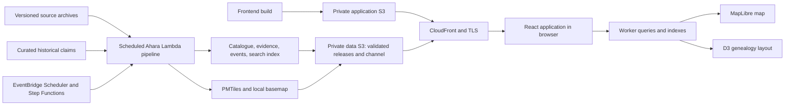

# Historical language atlas implementation plan

## Current contract: authored inputs and one calendar workspace — 2026-10-18

Implementation plan: `aab8e314-4542-4aae-b1f5-17d0e21b7ddd`.
The user approved capturing hand-authored data through the independent pipeline.
This supersedes worker-bundled editorial input and browser compatibility
conversions. Earlier milestone descriptions below record historical behavior.

Authored claims, identifier mappings and the source lock are versioned source
inputs in Git. CI validates them with fixtures and deploys code.
After successful deployment, its final job starts the existing pipeline with
the deployed Git SHA. Pipeline workers fetch, transform, validate and publish
the data; CI only triggers that execution. The worker ZIP contains
code, locked dependencies and the compiler, with no `data/` tree.

Source capture resolves the configured public repository ref, or an execution's
explicit revision, to a commit and persists that choice before file downloads.
It checks and snapshots the three authored JSON inputs under `sources/authored/`
with per-file SHA-256 values. Retries retain that commit. All later stages consume
the verified captured snapshot alongside checksum-pinned public archives. A
release preserves exact authored files and provenance as artifacts. Local builds
capture working files and identify them as `working-tree`, with base commit and
checksums, rather than presenting them as committed input.

The producer owns source interpretation, calendar normalization, joins and
validation. The static browser requires the published `calendar-v1` contract;
it formats dates and queries evidence without source-lock imports, epoch
conversion, rewritten notes or suppressed coverage gaps. Older incompatible
releases require an independent pipeline refresh and produce a clear loading
error until then. Successful deployments trigger that independent refresh;
scheduled and manual pipeline executions remain available.

Retain one map, one BCE/CE timeline, source inspection, uncertainty, alternatives,
and debounced URL persistence. Epoch citations live with captured input metadata
and appear through the release, not hardcoded frontend corrections.

### Unified workspace scope and source findings

The current request replaces the separate Contemporary / Traditional / Dated
history modes and calendar / model time selectors with one map and one BCE/CE
timeline. Source identity, uncertainty, and alternative research remain available
in evidence inspection. Static delivery and the independent data pipeline remain.
Local implementation and validation are authorized; publication is not requested.

Diagnosis of release `652803a2cccf995a6df2cebd` found 205 model locations,
153 model divergences, two alternative Bengali attestation dates, and one calendar
contact event. The calendar map was empty at every date. URL replacement ran on
every state update and exceeded WebKit's history write limit when scrubbing.

Settled design: one calendar date drives geography, coverage, events, and dated
genealogy. Primary controls expose date and selection; source controls live under
evidence options. Contemporary map evidence appears as a reference snapshot,
never extrapolated into ancient territory. Undated traditional records remain
inspectable as source material. Preserve every input row and original date.
Resolve model epochs from primary publications or their calendar exports before
calendar conversion. Missing epoch evidence remains a coverage limitation, not a
license to silently subtract ages from an arbitrary year.

Sulion root: `d46af7a5-824f-423a-88be-33bd692bc701`.
Milestone: `d64b92ab-667d-4318-8dfc-eb6aa12b78df`; execution branch:
`e2aea34f-4a39-4d03-a19d-15bc29246025`. Steps: source dates
`f992d518-88ed-43d1-97f7-d7d93b460593`, workspace
`6506bcfd-bcf0-4001-af8d-4191387cfb98`, validation
`10b03a7f-b3ec-4ffb-981a-7637bb8da2de`.

### U1 — Unified dated evidence and workspace

Scope: repair dating and temporal queries; unify the map, timeline, event and
selection flows; debounce URL persistence; retain sourced details and mobile use.
Acceptance: one date representation and no map/source mode selector; available
geography and non-geographic evidence are discoverable; unsupported intervals
explain their coverage and link to evidence; repeated scrubbing does not crash,
lose the final URL date, or apply an obsolete worker result.

Execution expansion:

1. Review primary source calendar calibrations; implement documented conversion
   with original ages retained, temporal coverage, and meaningful date tests.
2. Replace source modes with one calendar state and map composition; connect
   timeline navigation to observations, attestations, events and source details;
   coalesce URL writes and clean up pending work on navigation and unmount.
3. Run fixture CI, browser journeys including sustained scrubbing and navigation
   in WebKit, then build and inspect the full pinned release. Review desktop and
   phone layout locally. Keep remaining source coverage explicit.

Primary review resolved both source epochs to 2000 CE. Chang p. 195 footnote 1
defines BP, and Table 8 equates English 0 BP with 2000 CE. Bouckaert's original
supplementary KML places modern tips at `2000-06-01`. Source locators are recorded
in `data/sources.lock.json`; original model ages remain in generated records.
The prior unspecified-epoch conclusion below is superseded by this review,
as are the original separate map/time modes. Those older phase notes remain as
implementation history.

URL persistence waits 400 ms after state settles,
cancels on navigation/unmount, preserves history state and hash, and handles
browser history quota errors without crashing exploration.

The workspace now has one flat map, one BCE/CE timeline, coverage marks,
date-consistent playback, written evidence and event inspection. Source and
genealogy options sit under Date & evidence; the phone timeline stays compact.
Event details use the selection inspector. Map click choices are checked against
active records even while renderer filters settle. Undated traditional records
remain accessible in source inspection. Earlier located evidence remains limited
to the imported Indo-European research; no global ancient territories are claimed.

Acceptance includes captured-revision retry behavior, input checksum failures,
authored-source validation without downloads, a clean Lambda package, full local
data generation, and browser journeys for repeated scrubbing, navigation and
calendar evidence. Publication remains separate from local implementation.

Build a static application that connects language geography, genealogy, and time.
Serve the application and all data from a private S3 bucket through CloudFront.
Search, filtering, spatial selection, tree traversal, and temporal queries run in
the browser. Data import, geometry processing, and tile generation run as
independently scheduled Ahara pipelines. PostgreSQL, PostGIS, API services, and
runtime tile servers from the supplied design are replaced by published static
files. CI tests and deploys code, then starts the production data pipeline as
its final job. Data transformations and publication run in the pipeline workers.

The shared Ahara OG server supplies the HTML shell with static site metadata and
a preview image for crawlers. It does not read or query the language data; browser
assets and published datasets continue to use their S3 origins.

This document is the working implementation contract. The supplied design is at
`.sulion-paste/paste-2026-10-17T03-26-19-278Z.txt`; that directory must stay private
and excluded from future commits and site builds. The repository currently has
no application or infrastructure files and no commits at planning time. The initial planning
review is complete; local implementation is now authorized. The user
subsequently requested the shared pipeline design and child implementation plan
recorded below. No deployment, push, or
external publication is authorized by this plan.

## Product behavior

The desktop workspace has a flat map occupying approximately 70% of the main
area, a genealogy pane occupying 30%, search above, and shared time and evidence
controls below. Both panes have independent zoom and expansion state. Narrow
screens switch between map and tree while retaining the shared selection and
filters. On phones, a compact timeline sits above the map and remains visible
while scrolling; dates, sources, and events expand on request. An explicit
Lineage & dispersion control opens located source-model evidence with ancestry
links and dated genealogy. Links follow the selected lineage or branch; missing
source coordinates remain unavailable. A details drawer shows the selected language, ancestry, observations,
sources, dates, and qualifications.

- Selecting a language on the map highlights and reveals its ancestry in the
  tree. Selecting a branch highlights its descendant distributions. Family
  isolation is explicit and reversible.
- Search covers the entire imported catalogue, including alternative names,
  Glottocodes, ISO codes where available, extinct languages, and languages with
  no polygon. A missing polygon is reported as unavailable. A sourced coordinate
  may be shown as a point; it must never become an invented area.
- Family hues remain stable across releases. Branches and languages vary within
  their family hue. Evidence uses patterns, line styles, and text as well as
  color. Isolates and unclassified records retain their actual classification.
- Geographic detail progresses through families, branches, languages, and
  documented dialects. Tree detail is independently controlled. Aggregated
  geometry is labeled as a derived union of available observations, rather than
  a new observation or a complete territory.
- Preserve overlapping observations. Clicking an overlap offers the languages
  and source claims at that location rather than selecting only the top polygon.
  A source polygon assigned to a subgroup must not be duplicated across every
  descendant as if each language occupied its entire area.
- Contemporary and traditional Atlas distributions are separate source layers.
  Dated history is a separate time mode. A layer's publication year, reference
  year, or category does not establish a language's lifetime or continuous
  geographic validity.
- Historical mode defaults to a combination of supported observations and
  explicitly marked reconstructions. Users can restrict evidence kinds and
  compare alternative reconstructions. Unsupported regions stay unknown.
- Timeline playback switches evidence at supported boundaries. There is no
  automatic polygon interpolation. A transition animation may fade a feature
  but must not manufacture a migration or extend a claim's validity.
- The conventional genealogy remains available alongside a dated view for
  families with sourced divergence estimates. Undated nodes retain an explicit
  undated position; tree depth is never converted into a date.
- Optional contact edges and geographic ancestry connections use distinct
  styling. An ancestry connection does not represent a migration route. Only
  an independently sourced migration event may show one.
- The globe is an optional projection of the same selected data. Keyboard
  search, tree navigation, details, and evidence inspection remain available
  when WebGL is unavailable. Playback respects reduced-motion preferences.
- The URL can restore selection, layer, date, evidence filters, reconstruction
  variant, and camera. Sharing a URL requires no stored server state.

## Source findings and their consequences

Sources inspected on 2026-10-17:

| Source | Read evidence | Implementation consequence |
| --- | --- | --- |
| [Glottolog downloads](https://glottolog.org/download) | The site offers 5.3 languoid CSV, coordinates, and Newick classification; CC BY 4.0. | Pin 5.3 as the catalogue backbone. Read release records for aliases and status; do not infer dates from the classification. |
| [Glottography Atlas v2.0 release](https://github.com/Glottography/asher2007world/releases/tag/v2.0) | Released dataset DOI: [10.5281/zenodo.18613195](https://doi.org/10.5281/zenodo.18613195). | Prefer the primary released dataset over the example visualization repository. Pin its archive URL and checksum during M1. |
| [Atlas v2.0 README](https://github.com/Glottography/asher2007world/blob/v2.0/README.md) | CC BY 4.0; traditional maps are time-of-contact maps for the Americas and Australia, supplemented elsewhere with contemporary areas. | Explain proxy areas in the UI. Traditional does not mean a common date or a global precolonial reconstruction. |
| [Contemporary CLDF metadata](https://github.com/Glottography/asher2007world/blob/v2.0/cldf/contemporary/contemporary-metadata.json) and [traditional CLDF metadata](https://github.com/Glottography/asher2007world/blob/v2.0/cldf/traditional/traditional-metadata.json) | Tables, media links, and contribution fields were inspected. Metadata still names Glottolog 5.2 and an earlier generated repository revision. | Keep downloaded-release identity separate from embedded provenance. Reconcile identifiers and changed classification against 5.3; do not assume version alignment. |
| Atlas v2.0 CSV tables | Contemporary: 4,251 language-table rows and 5,600 contribution rows. Traditional: 4,729 and 6,181. Contribution rows include maps. `Year` values are blank/2007, plus `traditional` in the traditional set. | Count source features, languoids, aggregates, and map records separately. These counts are not counts of distinct living languages or historical snapshots. Preserve original map links and raw date labels. |
| [2025 dataset paper](https://www.utupub.fi/bitstream/handle/10024/196831/s41597-025-05828-6.pdf?isAllowed=y&sequence=1) | Methods through the contemporary/traditional section were read; later sections were not reviewed. Describes raw features and aggregated language/family areas, subgroup assignments, and limits on overlap representation. | Preserve source granularity and map-derived limitations. The renderer can support overlaps without claiming that this source exhaustively records multilingualism. |
| [D-PLACE aggregate](https://github.com/D-PLACE/dplace-cldf) | README describes constituent datasets and phylogenies; aggregate license is CC BY-NC 4.0. | Keep it out of the default redistributable bundle until permitted use is settled. Evaluate licenses of individual datasets and phylogenies separately in M3. |
| [Natural Earth terms](https://www.naturalearthdata.com/about/terms-of-use/) | Raster and vector data are public domain. | Package a geographic reference basemap locally; avoid map-provider keys and runtime third-party tile dependencies. |

The supplied design's 6,992 digitized areas are not a promise of a polygon for
every Glottolog language. M1 must account for every record in the pinned sources,
including unknown joins, subgroup-level mappings, and languages without geometry.
It must not reduce the project to a hand-picked demonstration.

Historical coverage is a data acquisition task. The Atlas alone cannot support a
global reconstruction from 3000 BCE to today. M3 will establish which dated
observations and reconstructions can actually be shipped. If a requested interval
has no evidence, the application shows that absence; it does not synthesize a
replacement map. The original 3000 BCE–present range can remain navigable, with
coverage marks and explicit empty states.

## Architecture and ownership



React/TypeScript and Vite own the application. MapLibre GL JS renders map and
globe; the PMTiles browser protocol fetches byte ranges directly from the same
CloudFront origin. D3 computes genealogy layout; React owns accessible controls
and selection state. Start with a reducer and focused hooks for shared state.
A Web Worker owns catalogue/search, descendant, and temporal indexes so expensive
queries do not block interaction. Abort obsolete fetches and discard stale query
responses after rapid date or selection changes.

Python with locked Shapely dependencies handles the source adapters,
geometry processing, and validation in Lambda stages. Pin the tile compiler,
PMTiles tooling, and Python dependencies. Build a managed-runtime Lambda ZIP.
Reuse those stage functions locally for
development and deterministic reproduction. Stable ordering and explicit tool
versions must produce identical data hashes from identical inputs. Run metadata
such as timestamps remains separate from the content-derived release identity.
Implement stages and adjust their partitioning from ordinary execution results.
There is no preliminary measurement gate. Shared pipeline infrastructure is a
prerequisite tracked below; language processing remains Atlas-owned.

Use PMTiles for global polygon and basemap layers, compact JSON for catalogue,
hierarchy, search metadata, and temporal coverage, and lazy JSON shards for
observation details and events. The app never fetches all polygon vertices at
startup. Precomputed family/branch tiles and descendant indexes support the two
independent levels of detail. Detailed tile features retain stable observation
IDs for lookup, overlap selection, and evidence filters. Small historical point
or event layers may use generated GeoJSON.

The manifest contains schema version, source versions and citations, build
identity, artifact paths and checksums, counts, supported evidence coverage, and
available reconstruction variants. Immutable data URLs include a content-derived
release identifier. The browser resolves `/data/v1/channel.json` once per session
and pins the compatible manifest it selects. That small channel has zero CDN
TTL and no-store headers; the referenced release objects are cached as immutable.
Dataset refresh and rollback execute in the data pipeline. Successful frontend
deployments start a refresh for their Git revision as the final deployment step.
The application never mixes release files midway through a session.

Initial performance targets, to be measured and revised with recorded evidence
in M2: under 3 MB compressed application/catalogue transfer before viewport
tiles; under 200 ms for selection/search after indexing on the recorded desktop
test machine; bounded tile and worker caches. Measure total memory and initial
load with full datasets and a throttled network. Use those results to choose tile
zooms, geometry tolerances, and shard sizes without silently dropping records.

Recommended repository layout:

```text
frontend/
  src/atlas/             shared state, queries, and URL state
  src/map/               MapLibre source/layer adapters and overlap selection
  src/tree/              genealogy and dated layout
  src/evidence/          details, source inspection, uncertainty controls
  src/timeline/          date controls, coverage, and playback
  src/data/              typed schemas and static-data loading boundary
  tooling/fixtures/      compact test data; not claimed as global coverage
  dist/                  deployable site; ignored
data/
  sources.lock.json      pinned URLs, versions, licenses, and SHA-256 checksums
  historical/            reviewed observations, relationships, and events
  mappings/              explicit cross-release identifier decisions
tools/data/              Python import/build package, lockfile, Dockerfile
pipelines/language-atlas/ source policy and native workflow definition
infrastructure/terraform/
scripts/                 data preparation and local deployment entry points
docs/ATLAS-PLAN.md        this plan and just-in-time phase expansions
platform.yml             Ahara project manifest
Makefile                 local build, checks, data, and deployment commands
AGENTS.md                repository guidance
```

Commit source manifests, curated claims, adapters, mappings, and pipeline
definitions. Production runs capture approved inputs in private S3 with hashes;
local reproductions use an ignored cache. A missing or mismatched input fails
the run rather than substituting a newer release or a tiny sample. Source updates
are explicit reviewable changes to the lock and affected mappings. CI exercises
adapters and consumer contracts with representative fixtures; complete-source
accounting is verified by independent full pipeline acceptance runs.

## Durable data contract

Keep these concepts separate even though they are delivered as static files:

| Record | Required meaning |
| --- | --- |
| Languoid | Stable ID, Glottocode when one exists, name/aliases, language/group/dialect kind, catalogue status, and independently sourced attestation information. Historical reconstructed entities without catalogue IDs use a project namespace. |
| Genealogical claim | Parent and child IDs, source, classification or proposed ancestry relation, evidence kind, optional divergence interval, and reconstruction variant. The default Glottolog classification is a backbone; competing sourced trees remain separately selectable. |
| Geographic observation | Stable observation ID, subject languoid/group, geometry reference, source/map/feature IDs, original temporal label, typed dating, evidence kind, geographic uncertainty, and any variant/conflict set. Multiple simultaneous claims are allowed. |
| Attestation | Language, source and locator, dated evidence interval, and what is documented. First attestation is not automatically an origin or divergence date. |
| Event | Divergence, migration, expansion, contact, shift, or extinction; participants, date interval, optional sourced geometry, evidence, sources, and qualifications. An event is not inferred merely from two polygons. |
| Source | Citation, resolvable URL/DOI, release and checksum, license, locators, and transformations. Distinguish original research from a digitization or derived aggregation. |

Distinguish a source's publication year, its claimed observation/reference date,
an observation's supported validity, and a language's attested lifetime. Use
explicit temporal cases: undated, reference-date-only, bounded validity, and
uncertain interval. A reference date alone does not justify a centuries-long
extent. An uncertain event date is a possible occurrence interval, not a duration
of continuous activity. Preserve precision and the original source wording.

Represent arithmetic dates as astronomical year integers: 0 is displayed as
1 BCE, -1 as 2 BCE, and 1 as 1 CE. The UI never displays a civil year zero.
Document interval inclusivity and unit-test BCE/CE boundaries. Unknown endpoints
remain unknown; do not replace them with slider endpoints.

Use attested, reconstructed, and hypothesized as evidence categories where
supported. Classification confidence, date uncertainty, and geographic uncertainty
are separate dimensions. Preserve source-provided numeric confidence with its
meaning; otherwise use a qualified label and explanation rather than inventing
a score. Cartographic observations are identified as map-derived evidence and
must not be relabeled direct historical attestation.

In historical mode, strict dated observations and uncertain reconstructions have
explicit inclusion rules and legends. Search can retain a selected modern
language at an ancient date while explaining that it has no active evidence.
It must not silently substitute an ancestor, infer extinction from a missing
record, or render modern descendants as contemporaneous ancient languages.

The import validates referential integrity, unique IDs, hierarchy cycles,
coordinate systems, geometry validity, interval ordering, licenses, and source
locators. Geometry repair and simplification record their transformations.
Preserve enclaves, holes, islands, antimeridian behavior, and overlaps; reject
silent record loss. A reviewed mapping must resolve a changed identifier;
ambiguous matches remain visible and cannot be chosen by name similarity alone.

## Ahara integration

Current local contracts were read in `../ahara/INTEGRATION.md`,
`../ahara/CI-WORKFLOW.md`, the reusable workflow itself, applicable
`../ahara-standards/standards/` files, `../ahara-tf-patterns/modules/website/`,
the managed-project module in `../ahara-infra/`, and PDFree's current static
hosting configuration. Use the current user instructions over the older
standards document's requirement for a `CLAUDE.md`; repository guidance belongs
in `AGENTS.md`.

### Atlas-owned configuration

- Project and resource prefix: `atlas`; repository: `chris-arsenault/atlas`.
  Public hostname: `atlas.ahara.io`.
- `platform.yml`: `project: atlas`, `prefix: atlas`,
  `typescript_dir: frontend`, and frontend/Terraform stack entries. Atlas
  Terraform supplies its native workflow definition to the reusable client
  module described in the [shared design](../../ahara/docs/data-pipelines.md).
  Declare actual worker packaging/code-deployment capabilities when implemented;
  do not use a Python Lambda stack flag as a generic data-processing hook.
  Browser engines are `[chromium, firefox, webkit]`; representative static
  consumer tests can use the standard container runtime without Docker nesting.
- Call `chris-arsenault/ahara/.github/workflows/ci.yml@main` with inherited
  platform secrets. Pipeline unit/schema/adapter tests, lint, and ZIP/code
  packaging are code checks, not production pipeline execution. Keep them in
  ordinary prerequisite jobs where the existing stack contract needs it.
  Browser journeys also gate application deployment.
- `pnpm build` builds only the frontend. It neither produces the full dataset
  nor starts a remote refresh. After code deployment succeeds, a final CI job
  starts the existing pipeline for the deployed Git SHA. Pipeline workers own
  production processing, validation and publication; schedules and operator
  commands can also start executions.
- The shared workflow invokes ESLint, TypeScript, and Vitest directly before its
  build. Keep their configuration and pure domain tests independent of generated
  production data. The manifest schema is a checked-in typed protocol, loaded
  through the static-data boundary at runtime. Browser tests serve committed
  representative fixtures or explicitly selected pre-existing immutable data;
  they do not start a production pipeline. Every entry point works independently
  in a clean checkout. Fixtures never establish full-source coverage.
- Provide `make build`, `make ci`, `make test-browser`, and `make test-release`
  plus explicit local reproduction/independent acceptance commands. `make ci`
  includes Python lint and fixture-based pipeline tests, frontend checks, and
  Terraform formatting. Full data acceptance runs outside CI. Use Ahara's pnpm,
  TypeScript, ESLint, Prettier, and Vitest conventions. Browser tests own and
  clean up temporary servers; development servers require an explicit request.
- Terraform uses `projects/atlas.tfstate` in `tfstate-559098897826`,
  region `us-east-1`, encryption, and S3 lockfiles. Require Terraform >= 1.14
  for the current shared module's deployment invalidation action. Pin the
  shared website module to the reviewed revision containing required fixes.
- Pass `prefix`, `hostname`, `site_directory = frontend/dist`, a security
  response-headers policy, and an explicit CloudFront price class. Recommend
  `PriceClass_100` initially; edge coverage can change with usage evidence.
- Keep `og_config` unset. Use static title/description/OpenGraph metadata.
  The application request path contains no Lambda, database, Cognito client,
  ALB rule, or VPC dependency. Scheduled pipeline compute is separate. Deliver
  basemap, glyphs, sprites, fonts, and atlas data at the same CloudFront hostname
  through the pipeline-owned private data origin. The client receives no AWS
  credentials or API keys.
- Follow the private S3 origin/OAC pattern already provided by the module.
  Use SSE-S3, as PDFree does, with `encrypt = false` to avoid a dedicated KMS
  key. Security headers must permit only necessary same-origin assets and
  MapLibre worker creation, verified against the production build.
- Ahara's shared workflow owns code builds, Terraform initialization and apply
  on `main`. Atlas passes the pinned shared-module revision and inherits the
  standard deployment behavior.

### Required changes outside Atlas

These are implementation prerequisites, not suggestions to defer into a README:

1. Implement the shared registry/job-status service, reusable client module,
   and shared observability in child phases 1–3. Add reusable website data-origin
   and cache support only as required by Atlas adoption in phase 4. Atlas owns
   the output bucket, data objects, and publication step; frontend Terraform
   must not upload or prune them. Its publisher sets data MIME metadata, so these
   objects bypass the website module's Terraform upload MIME map. Avoid
   whole-object encoding of PMTiles so byte-range offsets remain valid.
2. Verify Range requests using the actual PMTiles reader and a production-like
   static origin. [PMTiles](https://docs.protomaps.com/pmtiles/cloud-storage)
   requires HTTP Range support; [CloudFront supports range GETs from S3](https://docs.aws.amazon.com/AmazonCloudFront/latest/DeveloperGuide/RangeGETs.html).
   Require `206`, valid `Content-Range`, stable ETag, and correct tile decoding.
   Same-origin delivery avoids a separate data-origin CORS contract.
3. The module currently rewrites S3 403/404 responses to `index.html` with a
   200 status. The client must reject HTML or invalid bytes for data requests
   and give an actionable missing-asset message. Use URL query/hash state so
   no new routing service is required. If deployment tests show a need for
   configurable error handling, make that a focused shared-module change;
   do not assume absent files yield a normal JSON 404.
4. Keep data and basemap names content-versioned. Add the explicit zero-TTL,
   no-store channel behavior; use the module's no-cache HTML and invalidation
   for the separate application entry point. Test independent data/application
   releases, rollback, compatible schema channels, and session pinning.
5. In `ahara-infra/infrastructure/terraform/control/project-atlas.tf`,
   register the existing managed-project module with prefix `atlas`,
   `allowed_repos = ["atlas"]`, `allowed_branches = ["main"]`,
   `allow_pull_request = true`, `state_key_prefix = "projects/atlas"`,
   `module_bundles = ["website", "pipeline"]` once the new bundle exists, and
   `policy_modules = ["terraform-state"]`. Use the existing GitHub PAT
   input path and OIDC provider. Preserve the managed-project guardrails.
   This module provisions the project's deployer role and repository secrets.
   No RDS database registration is needed; pipeline control metadata uses the
   shared registry contract.

Publication order is shared service/permission prerequisites, shared client
module, then Atlas. The deployer registration must be applied before the first
Atlas deployment can authenticate.

### Cost and publication boundary

Reuse the existing `ahara.io` zone. Its CloudFront alias queries carry
[no Route 53 query charge](https://aws.amazon.com/route53/pricing/), and the
non-exportable [ACM certificate for CloudFront has no certificate charge](https://aws.amazon.com/certificate-manager/pricing/).
The proposed configuration adds no fixed-charge compute or dedicated KMS key.
S3 storage/requests and CloudFront traffic are usage costs, not zero cost:
see [S3 pricing](https://aws.amazon.com/s3/pricing/) and
[CloudFront pay-as-you-go pricing](https://aws.amazon.com/cloudfront/pricing/pay-as-you-go/).
The current shared website module does not create a WAF ACL; declaring its
website permission bundle is not evidence that one is deployed.

Scheduled pipeline compute, registry metadata, and artifact
retention add metered costs separately from static delivery. The shared design
keeps platform control-state costs separate from Atlas compute, storage, and
delivery costs. Use current prices and a reasonable usage estimate for required
cost review; a performance-measurement phase is not a prerequisite.

Before deployment, use estimated release size, expected traffic, cache behavior,
and current regional rates to record a monthly estimate here. Account for the
fact that each PMTiles range request is a request. Do not assume unused shared
free-tier allowances. Any proposed fixed monthly resource or new resource type
must meet `ahara-infra/AGENTS.md` cost-review requirements; explicitly obtain
approval for costs over $10/month under that rule. No such extra resource is
part of this design. AWS and repository-secret operations use the authorized
credential path; credential failure stops that operation.

Local planning estimate after cleanup (2026-10-17): four refreshes per month,
each using 600 aggregate worker-seconds at 8 GB, cost about $0.32/month in
[Lambda duration](https://aws.amazon.com/lambda/pricing/) before any free tier
at $0.0000166667/GB-second. The one standard-resolution Scheduler-delivery
[alarm](https://aws.amazon.com/cloudwatch/pricing/) adds about $0.10/month.
These are usage assumptions, not measured production timings. Allow $2/month
for the low-volume pipeline and small retained sources/releases, excluding
public traffic and the existing shared infrastructure baseline. S3 requests,
Step Functions transitions, DynamoDB summaries and scratch storage remain
metered; review actual bills after ordinary runs. Delivery cost remains
traffic-dependent and must be estimated when publication traffic is known.
There is no ECR repository, extra NAT, dedicated load balancer or KMS key.

## Milestones and acceptance

The complete application includes all milestones. M1/M2 establish the global
foundation, not a substitute for the historical requirements. Expand one
milestone just before execution using the `plan-phase` workflow; add the
expansion to this document rather than creating report files.

### M0 — Static architecture and implementation plan

Scope: translate the supplied specification into a buildable static architecture,
check source and platform contracts, identify ownership and evidence limits.

Acceptance: the data model, runtime boundary, full product scope, integration
changes, dependencies, decision owners, and milestone evidence are explicit.

Evidence: review this document against the supplied spec, source bodies, and
current local Ahara code. No runtime tests are required for this planning edit.

### M1 — Reproducible global dataset

Scope: bootstrap repo guidance/tooling, schemas, source lock, scheduled
download/import adapters, catalogue and source-preserving geographic observations,
identifier reconciliation, tile generation, immutable manifest, and full-data
validation. Reuse the implementation from child phase 4, Atlas pipeline adoption;
do not implement a second CI-based data producer.

Depends on: M0 and the Ahara pipeline-framework child plan. M1 is blocked on that
prerequisite; independent source/schema research can continue. Shared hosting
support is required before publication, not local source development.

Reproduction follow-up: `2f0fc532-b070-4bcd-8d75-3950734481c9` repairs
Tippecanoe's `generator_options` metadata, which embedded scratch paths even
though decoded tile contents were identical. Compile through stable relative
filenames, compare archives from different scratch directories, and regenerate
the full release before returning to M3. The focused real-compiler integration
passes, and two complete contemporary archives now share SHA-256
`f746dd18621381f4479d539208664eac7ea098c2c6caab370c01b8dced3b4bdb`.

Acceptance: an independent registered pipeline run produces the entire pinned
catalogue and both Atlas source layers; the same stages can be reproduced locally.
Every input row is accounted for as imported, retained unresolved,
or explicitly rejected with a reason. No silent join losses or invented dates.
Mismatched checksums fail; repeated runs from identical inputs match data hashes.
Generated global data is suitable for M2's map without per-request processing.

Evidence: exercise source import/schema contracts, cross-version joins, geometry
edge cases, artifact integrity, full-source counts, deterministic rebuild, and
PMTiles reads. Emit counts as pipeline logs and manifest metadata, not a separate
verification report. Confirm source licenses and citations in outputs. CI tests
contracts with representative fixtures; full-source acceptance is independent.

### M2 — Global map and genealogy

Scope: full React workspace, self-hosted basemap, MapLibre layers, independent
map/tree detail, D3 genealogy, full search, bidirectional selection and family
isolation, overlap picker, details/provenance, responsive layout, URL state,
loading/retry/error behavior, and accessible non-map exploration.

Depends on: M1.

Execution expansion: build indexed catalogue/search and shared URL state first,
then the map/tree workspace with independent detail and source inspection, then
exercise selections, source gaps, overlaps, responsive controls, and failure
states in all three browser engines. Use the completed full release for a final
consumer pass; CI's committed excerpt establishes contracts only. Keep one
shared selection and query service, and bound the rendered tree/tile caches.

Acceptance: search for Bengali and select it from search or geography to reveal
its imported ancestry; selecting an ancestor highlights available descendant
areas. Test other families, an isolate, a catalogue language without polygons,
an aggregate-only source area, overlapping observations, and dialect detail
where supplied. Switching contemporary/traditional does not imply a date.
Full-source coverage is available; detail/loading is bounded without data loss.

Evidence: domain tests for selection/descendants/filters and Vitest browser
journeys in Chromium, Firefox, and WebKit. CI uses representative fixtures;
independent full-data acceptance selects a completed immutable pipeline release.
Measure the stated performance targets on a recorded machine; test mobile layout,
keyboard controls, source links, missing assets, and WebGL failure behavior.

Local M2 outcome: search/selection, independent map/tree detail, source inspection,
overlap picking, URL restoration, mobile panes, and WebGL fallback are implemented.
Six domain/data tests and six workspace journeys pass in Chromium, Firefox, and
WebKit. Chromium and WebKit exercised real tile selection; Firefox's headless
environment used the fallback where WebGL was unavailable. A separate Chromium
journey loaded the full release and inspected Bengali, Basque, a subgroup-only
assignment, and Sumerian's unsupported historical geography. The compressed
catalogue/index total is approximately 1.71 MB; the main application is about
0.41 MB compressed. The publisher compresses JSON explicitly; PMTiles retains
uncompressed HTTP range delivery. No extended benchmark gate was introduced.

### M3 — Evidence-backed historical time

Scope: acquire and review dated historical sources, source-specific adapters,
attestations, reconstructed ancestors, uncertain/alternative genealogy claims,
historical observation indexes, coverage histogram, evidence controls, dated
tree view, and timeline selection.

Depends on: M2. Source review begins during M1 where it can inform schemas.

Execution expansion: import the separately licensed Phlorest Bouckaert 2012 and
Chang 2015 summary trees, retaining taxon mappings, source node ages, posterior
support, and original uncertainty annotations. Keep their conflicting models
separate. Their raw calibration files express years backwards from a model
present without establishing a calendar epoch. Preserve that source clock in
dated views and offer it explicitly in the shared timeline; never silently
subtract ages from 1950 or the current year. Calendar attestations remain a
separate supported evidence type. Review further sources for dated observations,
then add temporal coverage, uncertainty controls, dated tree layout, and browser
journeys against the generated historical data. DiACL v1.1 was inspected but its
metadata has an empty license and empty time_frame values, so it is not imported.

Use Indo-European and the Indo-Aryan/Bengali lineage as the first historical
integration case, while retaining the global catalogue. Select actual published
observations and at least one licensed, dated family phylogeny; inspect their
methods, dates, node mappings, and reuse terms before encoding claims. D-PLACE
points, if permitted, describe dated society observations and must not become
language-range polygons. A historical source inventory must precede claims of
coverage; no specific ancient extent is approved merely by its mention in the
supplied design.

Acceptance: dates filter supported evidence correctly, including BCE/CE,
reference-only dates, uncertainty, and gaps. Competing claims remain inspectable
and selectable. Dated divergence estimates and undated classification coexist
without false precision. An unsupported ancient region or modern language is
clearly unavailable at that date. Source inspection explains each displayed
claim. The supported coverage is documented in the product's data manifest.

Evidence: tests of actual temporal semantics and source adapters; browser
journeys that move between modern and historical evidence, switch evidence
kinds and reconstructions, inspect sources, and retain selection through gaps.
Review imported claims against their cited passages. Record the verified initial
regional/time coverage here when known; do not mark M3 complete with empty data
or fixtures alone.

### M4 — Linguistic events and overlays

M3 implementation coverage: 308 source phylogeny nodes, 306 relationships,
205 located Bouckaert model nodes, and two alternative Charyapada composition
chronologies are imported alongside the complete global catalogue. All 155
sample taxa reconcile to Glottolog 5.3. Chang supplies ages but no geographic
estimates. Calendar coverage is textual attestations; model geography uses its
own clock and has no asserted calendar epoch. No ancient territories are drawn.
Adapter, date/filter, and browser scenarios exercise these actual releases.

Scope: source-backed divergence, migration, expansion, contact, shift, and
extinction events; event details and timeline markers; playback; optional
geographic ancestry and contact overlays; optional globe.

Depends on: M3.

Acceptance: selecting an event connects its participants, geography where
supported, time interval, and evidence. Playback advances through actual claims
and gaps without geometric interpolation. Geographic genealogy uses only sourced
ancestral locations, labels its relation type, and cannot be mistaken for a
documented route. A competing reconstruction changes the relevant claims
consistently. Globe and flat map preserve selection and evidence controls.

Evidence: domain and browser scenarios using reviewed event data, overlap and
variant cases, rapid playback/filter changes, independent tree zoom, reduced
motion, and globe/flat-map transitions. Missing event categories are disclosed
as source gaps rather than populated with invented examples.

### M5 — Ahara integration and release readiness

M4 implementation: source summary trees supply 153 proposed divergence events;
one separately cited calendar contact event covers Persian/Arabic borrowing in
Bengal. Event inspection links participants, dates, locators, and available
model geography. Playback visits evidence boundaries and gaps. Dashed ancestry
links use supplied model locations. Contact without historical coordinates
remains inspectable without a route. Eight domain tests and eight browser
journeys pass; Chromium, Firefox, and WebKit retain event/selection state through
flat/globe changes. Other event categories remain documented source gaps.

Scope: prepare and validate the shared-module changes, actual local deployer
registration, Atlas Terraform, CI, build/deploy scripts, security headers, static
metadata, operational docs, and full production-build journeys. Local hosting
preparation can run alongside M1/M2; final readiness depends on M4.

Depends on: M1–M4 for final product readiness; the reviewed shared module and
Ahara deployer role must be published/applied before an Atlas deployment.

Acceptance: the application build contains only public application assets and
consumes an independently published compatible dataset through its static
channel. Shared CI tests and deploys code; the final Atlas job starts the
production data pipeline. Data transformations run outside the CI runner.
Terraform owns application objects and hosting/compute definitions,
while pipeline output objects remain separately owned. Required cross-repo edits
exist and pass their applicable local checks. Deployment instructions preserve the
actual dependency order and identify unpublished prerequisites.

Evidence: `make ci`, independent full-data production browser journeys in the
three engines, shared website regression checks, Terraform formatting and safe validation,
production-like range/MIME/cache/security-header checks, source-data licensing
review, and a reviewed cost estimate. Credential-backed Terraform planning
requires available authorized credentials; do not confuse offline validation
with a deployed result.

The removed custom HTTP harness previously simulated caching/security headers;
those assertions were not evidence of CloudFront behavior. Its replacement uses
Vite preview solely for built-application and binary-range journeys. Shared
Terraform mock plans check cache/data-origin configuration, and actual response
headers remain part of post-deployment verification.

Publish and apply the prerequisites in order. The shared workflow deploys Atlas
on `main`; then verify HTTPS, actual
range responses/tile decoding, browser behavior, source links, and release-cache
behavior at the chosen hostname. Report live failures from actual logs. Local
release readiness and successful live deployment are separate claims.

## Decisions and next action

Shared-CI adoption uses Ahara's existing Python `scripts/build-lambda.sh` hook
for ZIP packaging and its existing Terraform deployment step. Atlas's CI
workflow is a caller; adapter and browser tests gate it, and pushes to `main`
use the shared deployment defaults. The caller pins the shared-module SHA;
Terraform owns hostname and schedule configuration. Optional Python paths
preserve existing backend/src defaults. Data refresh remains a separate execution.

Cleanup approved after implementation review: use a Python Lambda ZIP with
Lambda-compatible native dependencies; remove production ECR/image support and
its separate registry state. Replace the bespoke Python HTTP test server with
the existing Vite/browser tooling. Keep only small synthetic browser fixtures
in Git; complete source downloads and generated releases stay in ignored caches
and production S3. Each pipeline stage transfers only its required files.
`data/historical/claims.json` is explicitly reviewed editorial input, distinct
from automatically imported upstream datasets. Shared registration, job status,
Scheduler, native Standard workflows and centralized observability remain.

Cleanup branch `55e5bdd1-d38e-4422-b7ab-821ac3a97a47` completed locally:
the managed-runtime ZIP imports the worker and compiles/decodes a real tile;
the existing binary and new Python ZIP Terraform plans pass. Browser fixtures
are now tiny synthetic inputs, with generated releases in ignored per-engine
caches. A stage-transfer regression checks required archives and the five-file
layer hand-off. `make ci`, shared infrastructure CI, ten shared module mock
plans and full-data built-application journeys pass across Chromium, Firefox
and WebKit. Local preview uses Vite; CloudFront headers and deployed execution
behavior remain unverified. Historical editorial sources are explicitly labeled.

Settled: static S3 application delivery, no application backend, scheduled
Lambda data preparation outside CI, browser queries, complete available global
coverage, distinct source/temporal semantics,
explicit evidence and alternatives, existing Ahara website/CI conventions.

Provisional: Glottolog 5.3 + Atlas v2.0 with explicit
reconciliation, initial performance budgets, Natural Earth reference basemap,
and PriceClass_100. Verify archive identity and joins in M1 and performance in
M2. Adapt implementation from evidence without changing the static boundary
or dropping product requirements.

Deferred decisions:

- User owns any intended commercial use decision needed for CC BY-NC material.
  The implementation can proceed using permissively licensed sources; do not
  import the D-PLACE aggregate by default.
- Implementation owns selecting historically useful sources and reconciling
  their dates, language IDs, and licenses. Establish actual M3 coverage before
  claiming historical completeness. Surface any requirement that evidence
  cannot support instead of filling the gap.
- User owns any scope change if the intended historical coverage requires data
  rights or research beyond the available reusable sources.

M0 review is complete: the original plan was checked against the supplied design, the
versioned Atlas metadata and CSV bodies, and current Ahara hosting/CI code.
The review caught the missing map-asset MIME mappings and the Python-stack
Lambda build behavior. The revised ownership model assigns data MIME metadata
to the publisher and keeps dataset processing outside CI. The
planning document passed a whitespace check. The user's subsequent pipeline
decision supersedes its CI-based preparation model; current integration uses
the shared scheduled framework described below. Subsequent milestones locally
checked application behavior and complete imports. Deployed behavior remains
unverified until separately authorized publication.

The ownership split and simplified scope are approved. Shared registry/status,
the reusable workflow module, and shared observability/docs are implemented
locally. Atlas adoption and M2–M5 are locally implemented and checked. Nothing
has been deployed or published.

## Sulion mapping

Root plan: `aa48bf09-3154-4912-9aee-989c765b8836`.

| Milestone | Phase ID | State |
| --- | --- | --- |
| M0 | `bac5d774-fe77-4f4d-b2aa-ec8647651fb4` | Completed: plan and source/platform review |
| M1 | `e32ed789-0a14-46d5-ae11-4a6f85c07a37` | Completed locally: complete pinned sources and reproducible artifacts |
| M2 | `62e426ae-a29d-4732-aa8b-82d54b1d0256` | Completed locally: map/genealogy workspace |
| M3 | `b8ca64ee-94eb-4e08-88e2-b3916017ea33` | Completed locally: source clocks, alternatives and historical adapters |
| M4 | `6ab1f405-a564-4e7f-b53a-049e1149ed68` | Completed locally: events, playback and overlays |
| M5 | `543c84e9-4acc-4749-a65e-9462ad8cf137` | Completed locally: ZIP deployment, CI, docs and browser checks; publication separate |

Execution expansions will record their branch and step IDs beside the relevant
milestone. Keep this root open until the implementation outcomes are met; a
completed planning phase does not mean the application is built.

## Ahara pipeline framework sub-plan

The user requested this shared ecosystem feature on 2026-10-17, replacing the
earlier proposal to operate data production in CI. The canonical design is
[Ahara scheduled data pipelines](../../ahara/docs/data-pipelines.md). Product
behavior and evidence requirements elsewhere in this document remain intact.

Child plan: `1ab94d8f-1834-4c2b-879c-34df49c7fef6`, anchored to M1
`e32ed789-0a14-46d5-ae11-4a6f85c07a37` and M5
`543c84e9-4acc-4749-a65e-9462ad8cf137` of root
`aa48bf09-3154-4912-9aee-989c765b8836`. The shared implementation is complete
locally and the child is closed. Atlas adoption and final local product
acceptance follow that prerequisite; deployment remains a separate action.

### Accepted scope and ownership

The user approved this simpler split after reviewing current Ahara registration
patterns. `ahara-infra` admits projects and owns shared services. Clients create
their resources through reusable modules in their own Terraform state and write
their own registrations into the platform-owned store.

Keep DynamoDB registration and job status. Registrations contain project,
pipeline, description, workflow ARN, schedule, and owner. Jobs contain execution
ARN, pipeline identity, status, start/end times, and bounded failure information.
Client Terraform owns registration items; the shared status recorder owns job
records. Step Functions retains detailed task history.

The platform does not interpret language data or manage dataset publication.
Atlas owns its workflow, worker code, sources, schedule configuration, output
bucket, validation, manifest format, publication step, and domain dashboards.

Use native workflow retries/catches and existing telemetry. Remove custom
lifecycle Lambdas, distributed leases, deduplication ledgers, continuous
reconciliation, transactional publication/outbox machinery, custom operator CLI,
worker SDK, and the preliminary measurement/feasibility gate. Overlapping runs
are initially allowed; workers tolerate retries. Implement and adjust from
ordinary runs without weakening source accounting or data correctness.

### 1. Shared registry and job status

Owner/files: `ahara-infra/infrastructure/terraform/services/pipelines.tf`, shared
status-recorder backend, platform discovery, and control-layer permission
primitives/managed-project bundle. Names follow existing repository conventions.

Change: create shared on-demand registration and job-status tables, publish their
identifiers through SSM/platform context, and record native execution-status events
for registered workflows. Add scoped client deployment/registration permissions.
Preserve the existing control/services dependency direction and guardrails.

Acceptance: registration and runtime status have separate ownership; a client
cannot write another project's registration. Repeated/out-of-order events cannot
regress a terminal job status. Unregistered workflows are ignored. Registry entries
can exist before any execution. No lifecycle or dataset-publication service is added.

Evidence: focused recorder/status and permission tests, Terraform validation,
and applicable repository checks. Missed execution events are an operational
limitation addressed through AWS inspection/manual repair, not a new poller.

Depends on: accepted design. Sulion: `6e28f85b-a203-4970-9c35-661f791cbd8c`.

Execution: implement the recorder and conditional job updates, then wire shared
tables, event delivery, discovery, and client permissions. Verify with focused
Rust tests, Terraform/module checks, and relevant existing CI gates. Local
implementation of both plans is authorized; deployment and pushes are separate.

Local execution evidence: shared infra `make ci` and offline Terraform validation
passed. Recorder unit tests and DynamoDB Local integration cover unregistered
events, duplicates, delayed transitions, and redrives. The workflow module has
two passing mock plans; Lambda has two, and website has six including existing
consumers and the separate uncached channel/range-data origin.

### 2. Reusable client pipeline module

Owner/files: `ahara-tf-patterns/modules/pipeline`, necessary platform-context
outputs, and module tests.

Change: accept a client's native workflow definition, worker ARNs, schedule,
identity/description, and shared context. Create the client-owned Step Functions
Standard workflow, EventBridge Scheduler schedule, scoped roles, delivery DLQ,
and registration item in the shared table. Workers and artifact storage are
client inputs/resources, not platform-managed transformations.

Acceptance: the same module can serve another project without Atlas-specific
code. All instantiated resources and the registration item live in client
Terraform state. Native Retry/Catch/Map/Parallel behavior remains available;
there is no custom workflow language or lifecycle wrapper.

Evidence: module/ASL validation, scoped-role and registration checks, representative
module tests, and regression checks for any existing shared code changed.

Depends on: phase 1. Sulion: `59d1c658-0f18-4767-89a1-02dddabdd47f`.

### 3. Shared observability and integration docs

Owner/files: shared dashboards/alerts in `ahara-observability`, existing telemetry
integration in `ahara-infra`, and integration documentation in `ahara`.

Change: add cross-project pipeline/job views and failure/delivery alerts using
the existing OTEL, Loki, Tempo, VictoriaMetrics, and Grafana paths. Document
client admission, module invocation, registration/status ownership, and ordinary
AWS CLI/console start/stop/inspect/retry operations.

Acceptance: platform telemetry correlates project, pipeline, and execution without
per-execution metric labels. Domain data counters stay in client dashboards.
Registry inventory distinguishes never-run pipelines from unregistered work.
No new telemetry SDK, operator CLI, public control API, or reconciliation service.

Evidence: applicable dashboard/config checks and telemetry/status integration
tests. Live delivery remains unverified until an authorized deployment.

Depends on: phases 1–2. Sulion: `fcb836d3-2132-4d95-9e55-28987ab393a8`.

### 4. Atlas pipeline adoption

Owner/files: Atlas `pipelines/`, `tools/data/`, worker packaging, source lock,
Terraform, static-data consumer, and domain fixtures. The central
`ahara-infra/control/project-atlas.tf` entry grants platform admission only;
Atlas Terraform instantiates its workflow/schedule and writes its registration.

Change: fetch pinned Glottolog/Atlas/curated-history inputs; reconcile identifiers;
generate catalogue/search/temporal data and tiles; validate the full dataset;
write an immutable S3 release; update the static manifest after success. Atlas
owns publication and CloudFront data delivery. Add reusable website/Lambda support
in `ahara-tf-patterns` only where this concrete consumer needs it.

Acceptance: all available source records remain accounted for with provenance,
correct geometry/dates, and real tile reads. A failed run before manifest update
leaves the previous release selected. Frontend deployment starts the pipeline
after success; frontend Terraform cannot upload/prune its output objects. Clients
pin a complete compatible release for their session. No benchmark prerequisite,
publication transaction service, approval workflow, or automatic rollback service.

Evidence: focused source/adapter tests, ordinary full-source pipeline execution,
static consumer/range checks, and applicable code checks. Fixtures in CI test
contracts and do not establish global source coverage. Inspect runtime failures
and adjust stages as needed; live AWS behavior requires authorized deployment.

Depends on: phases 1–3. Sulion: `b1223d09-250d-46f4-971b-f53fc3aeeb36`.

Local adoption outcome: pinned complete sources produce 27,177 Glottolog
languoids plus 279 retained unresolved source identifiers, with 5,509
contemporary and 6,085 traditional observations. All contribution/language rows
are retained in source tables. Geometry uses direct GeoJSON reads and Shapely;
GeoPandas would add a dataframe layer without changing these EPSG:4326 inputs.
The Lambda container completed the full build with real PMTiles decoding.
Four Python tests cover identifier ambiguity, geometry holes/antimeridian parts,
checksum failures, interrupted publication, and safe retries. Three browser-data
boundary unit tests cover incompatible channels and immutable integrity checks.
Atlas owns its native ASL, ZIP-packaged Python worker, versioned data bucket,
and website instance. The earlier container/ECR implementation was removed
after review. Module sources use the ignored `.ahara-tf-patterns` directory;
the shared workflow checks out its published immutable revision there.
Local development links the existing sibling checkout. Complete historical inputs are
now imported in M3. No production workflow or registration has been deployed.

### Plan state

The accepted design replaces the original unstarted P1–P5 phases. Those phases
are marked skipped in Sulion with a superseded note, preserving history without
claiming implementation. P0 remains completed with the accepted scope recorded.
The shared registry/status phase passed Rust unit and DynamoDB Local integration
tests and offline Terraform validation. The client module passed two Terraform
mock plans. Shared observability passed its repository's `make ci`; npm reported
11 existing dependency vulnerabilities in the source-panel plugin. No resources
have been deployed. Root Terraform init attempted S3 access without credentials
and failed with `No valid credential sources found`; that operation was stopped.

### Publication order and return to Atlas

Publish/apply the shared service and permission prerequisites, publish the shared
client module, then deploy Atlas's own workers/workflow/schedule/registration and
hosting through the standard shared workflow. No shared lifecycle package or
dataset coordinator is required.

When all child implementation milestones meet their acceptance, run
`sulion plan return --completed`, reread the root, and reconcile M1 against the
consumer work. Mark M1 complete only if its full-source acceptance is established.
Resume M2; M5 still requires final-product release readiness. Do not close the
child merely because the plan update or shared module is complete.
